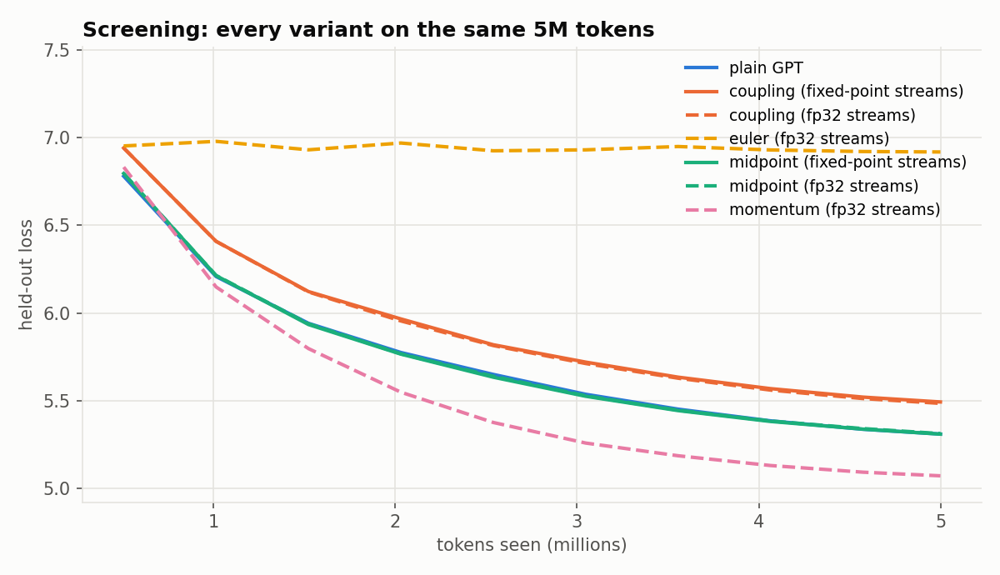
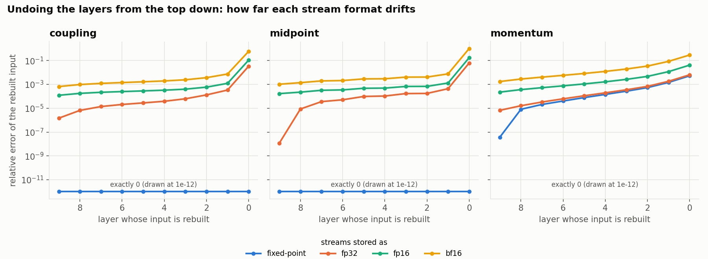
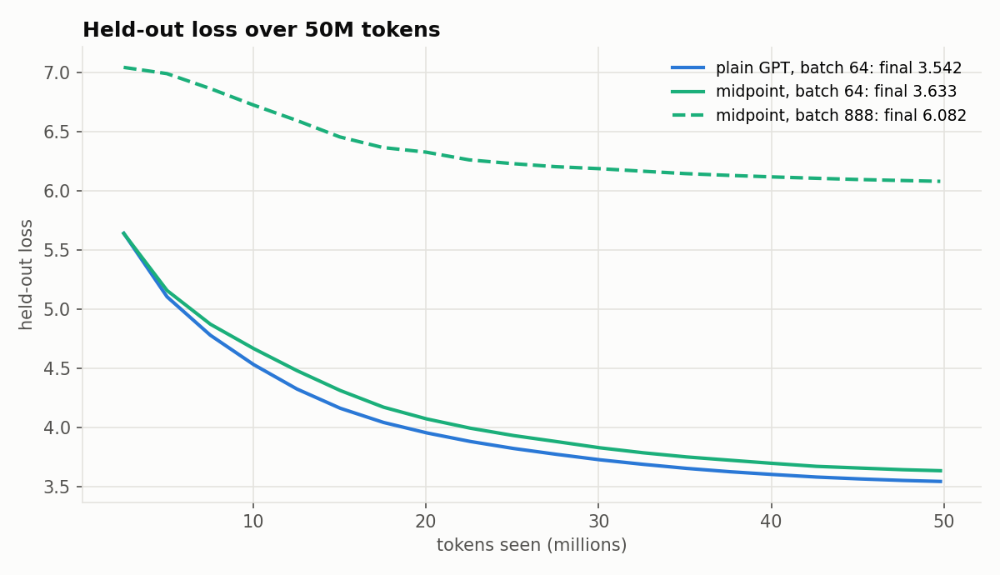
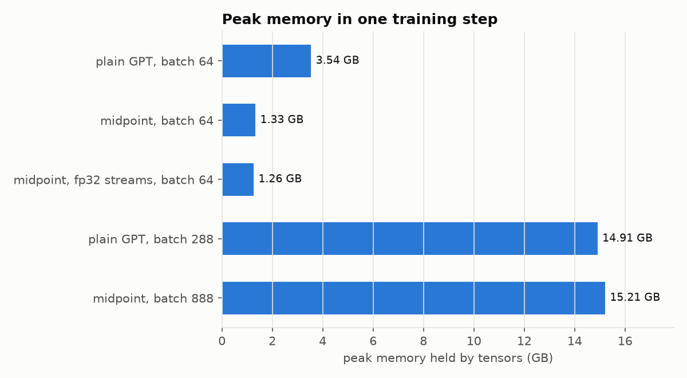
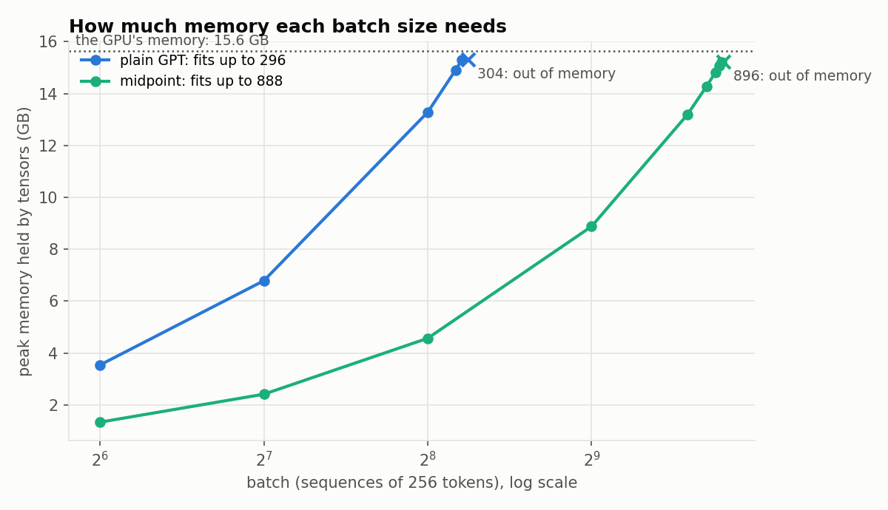
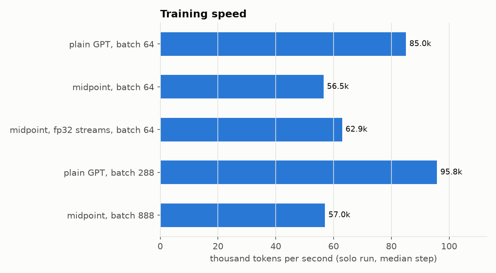
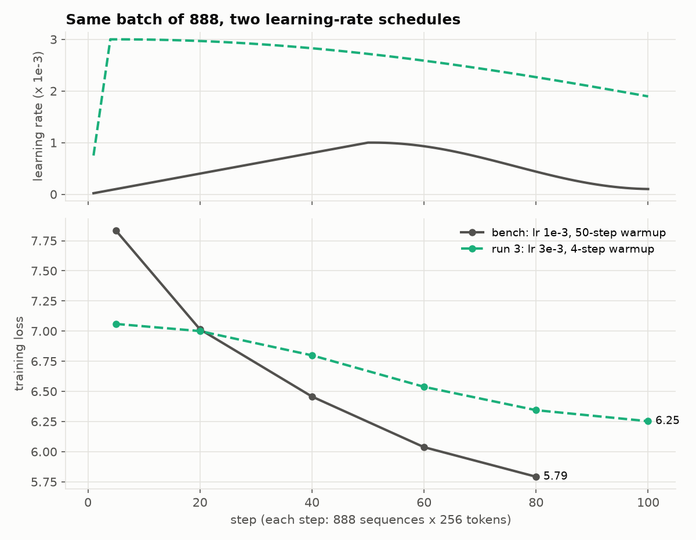

# Reversible GPT: undo instead of remember

A 19.4M-parameter GPT trained on 50M tokens three ways: plain, reversible at the same batch, and reversible at the largest batch that fits. The reversible backward pass rebuilds each layer's input from its output instead of storing it. Four reversible designs were built and screened (coupling, midpoint, euler, momentum), each checked against ordinary autograd before training.

`guide.md` explains every piece from scratch, for a reader who has never trained a neural network.

## Setup

| | |
|---|---|
| Model | a10's GPT at 10 layers: width 384, 6 heads, context 256, tied embeddings, 4,096-token BPE, **19,382,016 params** |
| Data | FineWeb-Edu, **50M train tokens** (one pass), 0.5M held-out tokens. a10's tokenizer; the held-out file is byte for byte a10's |
| Hardware | Google Colab, 1x NVIDIA T4 (15.6 GB), one run at a time. The notebook also runs on Kaggle's 2x T4, one run per GPU |
| Precision | fp16 autocast with loss scaling, fp32 weights and AdamW state. Reversible streams between layers stored as fixed-point int64 (see Findings) |
| Batch | runs 1 and 2: 64 x 256 = 16,384 tokens/step, 3,039 steps. Run 3: the largest batch that fits, found by probing (888 x 256, 219 steps) |
| Optimizer | AdamW (0.9, 0.95), lr 1e-3, 50 warmup steps, cosine to 1e-4, wd 0.1, clip 1.0 (a10's). Run 3: lr x sqrt(batch / 64), capped at 3e-3, warmup 1.6% of steps. This schedule broke run 3, see Results |
| Notebooks | `reversibility.ipynb` (everything, one cell per stage, Kaggle / Colab / Mac); `parallelism.ipynb` (six ways to split training across GPUs, checked on CPU) |

## The four reversible designs

All four reuse a10's block unchanged (LayerNorm, attention, LayerNorm, MLP) and so have exactly the plain GPT's 19,382,016 parameters. A(x) = attn(ln1(x)), M(x) = mlp(ln2(x)), F(x) = the whole block's correction.

| variant | forward | undo |
|---|---|---|
| coupling (RevNet / Reformer) | y1 = x1 + A(x2), y2 = x2 + M(y1) | x2 = y2 - M(y1), x1 = y1 - A(x2) |
| midpoint (leapfrog) | x[n+1] = x[n-1] + F(x[n]) | x[n-1] = x[n+1] - F(x[n]) |
| euler (the plain GPT) | x[n+1] = x[n] + F(x[n]) | 3 fixed-point repeats of x = y - F(x) |
| momentum (MomentumNet) | v' = 0.9 v + 0.1 F(x), x' = x + v' | x = x' - v', v = (v' - 0.1 F(x)) / 0.9 |

`RevStack` (in `rev.py`) runs the stack keeping only the final state. Its backward walks the layers from the top, recomputes each block once with autograd on, and uses that one evaluation both to rebuild the layer's input and to push the gradient through. Extra work: one forward pass of the blocks per step (euler: four).

## Results

The full experiment ran on Google Colab with one T4, torch 2.14.1, in November 2026. Every number below comes from the executed `reversibility.ipynb`, and none is estimated.

**The short version.** Rebuilding activations instead of storing them works on a GPT, and it can be made exact. At the same batch, the reversible model needs 2.7x less memory and fits 3.0x the batch. In exchange it trains 34% slower and ends 0.09 worse in held-out loss. Run 3 was supposed to show what that extra memory buys, and it failed. The failure came from its learning-rate schedule, not from reversibility. It hasn't been rerun yet.

### 1. Picking a design

Four ways to make the layers reversible went head to head on the same 5M tokens. Euler, the plain GPT run backwards, never learned. Its flat line near 7 means its undo diverges, so the gradients it gets are wrong (379x further from the true gradient than plain autograd's). Coupling learned but trailed the plain GPT the whole way. Midpoint tracked the plain GPT almost exactly: 5.344 against 5.345 at 5M tokens.



Momentum is the surprise. It beat everything, ending 0.25 below the plain GPT, and the selection rule still ruled it out. The rule requires every layer to rebuild its input to within 1e-3, and momentum's undo drifts to 6.4e-3, because it divides by 0.9 at every layer. Its gradients were as accurate as plain autograd's, though. Whether its lead survives 50M tokens is the most interesting question this run leaves open.

So midpoint went on to the 50M-token runs.

### 2. Making the undo exact

To undo a layer, you subtract what it added: x = (x + f) - f. In floating point that isn't always true. The sum rounds, and subtracting f doesn't bring back the bits that were rounded away. The error is tiny for one layer. Rebuilding from the top down, each layer starts from the previous layer's slightly wrong input, so the error grows.



By layer 0, midpoint's rebuilt input is 6% off with fp32 streams, 17% with fp16 and 102% with bf16. The fix is to store the streams as int64 counts of 2^-24, which turns every add and subtract into exact integer math. With that format, coupling and midpoint rebuild every layer's input bit for bit: the blue line sits at exactly 0. Their gradients come out as close to an fp64 reference as plain autograd's (0.95x to 0.97x its error). Momentum still drifts with fixed point, because division isn't exact in integers either.

### 3. Fifty million tokens



The reversible model (green, solid) follows the plain GPT (blue) all the way down and ends at 3.633 against 3.542. The two were level at 5M tokens, so the gap opens later in training. Midpoint is a different wiring of the same blocks (each layer adds to the state from two layers back), not a memory trick on an identical model, so some gap is no surprise. Samples from the two models read about equally well.

The green dashed line is run 3, covered in section 6.

### 4. Where the memory went



At batch 64 the plain GPT peaks at 3.54 GB and the reversible one at 1.33 GB. Autograd saves 2,617 MB of activations for the plain GPT and 410 MB for the reversible model, 6.4x less. Across the 10 blocks, the reversible model keeps only two int64 streams (101 MB). Most of what remains (268 MB) is the fp32 log-probabilities that cross-entropy keeps for its backward pass. That is the next target, and computing the loss in chunks would shrink it.

The more useful number is how large a batch fits in the T4's 15.6 GB:



The plain GPT fits 296 sequences and the reversible one 888, 3.0x more. At 296 the plain GPT is right at the edge: a 100-step run at that batch ran out of memory, and it fit at 288.

### 5. What it costs in speed



The reversible model trains 34% slower, at 56.5k tok/s against 85.0k. Most of that is arithmetic. Rebuilding each layer means running the blocks forward a second time, which adds 31% to the work per token. Fixed point adds about 10% more: the same model with fp32 streams runs at 62.9k, but those streams don't undo exactly.

A bigger batch speeds up the plain GPT by 13% (95.8k at batch 288). It barely changes the reversible model (57.0k at batch 888), because at batch 64 the reversible model is already limited by arithmetic, not by how full the GPU is.

### 6. Run 3: a failure, and what caused it

Run 3 trained the reversible model at its largest batch, 888, on the same 50M tokens. That is only 219 steps. It finished at 6.08, and its samples are common words in no order.

The notebook also ran a 100-step speed bench at the same batch of 888. Both runs start from the same weights and see the same batches in the same order. The learning-rate schedule is the only difference, which makes this a clean experiment:



*Dots are the steps the notebook printed. The run folder has every step, and `plot.py` draws them all.*

Run 3 (green, dashed) drops faster for 5 steps, then stalls near 7. The bench (gray) passes it by step 40 and is 0.55 lower by step 80.

The top panel shows why. Two rules set run 3's schedule:

- **Scale the learning rate by the square root of the batch.** sqrt(888 / 64) = 3.7, so 1e-3 became 3.7e-3, capped at 3e-3. The idea is that a bigger batch averages away gradient noise, so you can take bigger steps.
- **Keep warmup at the same share of training.** Run 2's 50 warmup steps are 1.6% of its 3,039. 1.6% of 219 is 4 steps.

So run 3 hit 3e-3 at step 4. AdamW's first updates move each weight by about the learning rate, whatever its gradient says. A typical weight starts at 0.02, and an output projection at 0.0045. One step at 3e-3 moves them by 15% and 67%. The bench's first step moves them by 0.1% and 0.4%.

A bigger batch does lower the gradient noise. It doesn't make the loss surface any less steep at the start of training, and that steepness is what makes large early steps unsafe. Getting past it takes some number of steps, not some share of the run, and 4 steps isn't enough.

One more comparison makes the point. At step 220, run 2 (batch 64) had a training loss of 5.37 after 3.6M tokens. Run 3 had 6.10 after 49.8M. Each of its steps averaged 13.9x more text and still did worse, so the large batch wasn't being used.

The 6.08 measures a bad schedule, not a reversible model at large batch. Even with a sound schedule, 219 steps is very few for this model, and I expect run 3 to finish behind run 2.

### What's next

1. **Rerun run 3 with lr 1e-3 and 50 warmup steps.** That is about 15 minutes on a T4, and it answers the question run 3 was meant to ask.
2. **Run momentum for 50M tokens.** It had the best loss in screening and was excluded only by the undo rule.
3. **Spend the memory on depth or context.** On a fixed token budget, a larger batch mostly means fewer steps. A deeper model or a longer context at batch 64 tests what the memory is worth more directly.
4. **Chunk the loss.** 268 of the 410 MB the reversible model still saves is the loss, not the layers.

<details>
<summary>All the numbers</summary>

| run | batch | steps | final held-out loss | tok/s | peak memory | MFU | HFU | job time |
|---|---|---|---|---|---|---|---|---|
| 1. plain GPT | 64 | 3,039 | 3.5421 | 85,047 | 3.54 GB | 15.2% | 15.2% | 10.7 min |
| 2. midpoint, fixed-point streams | 64 | 3,039 | 3.6328 | 56,523 | 1.33 GB | 10.1% | 13.2% | 15.7 min |
| 3. midpoint, largest batch | 888 | 219 | 6.0816 | 57,028 | 15.21 GB | 10.2% | 13.3% | 15.4 min |
| plain GPT, bench only | 288 | | | 95,779 | 14.91 GB | 17.1% | 17.1% | |
| midpoint, fp32 streams, bench only | 64 | | | 62,943 | 1.26 GB | 11.3% | 14.7% | |

Speed, memory, MFU and HFU come from separate 100-step bench runs, each alone on the GPU. Job time covers the whole training job, evals included.

Screening, 5M tokens at batch 64. A variant is eligible when its gradient error against fp64 is at most 1.5x plain autograd's and its worst rebuilt input is within 1e-3. The lowest loss wins, and among variants within 0.02 of it, the fastest.

| run | held-out loss, last 3 avg | tok/s | gradient error / plain | worst undo error | eligible |
|---|---|---|---|---|---|
| plain GPT | 5.3451 | 88,919 | 1.00 | - | reference |
| coupling, fixed point | 5.5284 | 53,489 | 0.97 | 0 | yes |
| coupling, fp32 | 5.5202 | 64,724 | 1.24 | 2.9e-2 | no |
| midpoint, fixed point | 5.3441 | 57,494 | 0.95 | 0 | winner |
| midpoint, fp32 | 5.3471 | 63,466 | 1.02 | 6.2e-2 | no |
| momentum, fp32 | 5.0994 | 60,623 | 0.99 | 6.4e-3 | no |
| euler, fp32 | 6.9230 | 38,632 | 379.72 | 3.6e+3 | no |

T4 precision: fp16 matmuls run at 27.0 TFLOPS, fp32 at 4.3 and bf16 at 2.5, because the T4 emulates bf16. Training runs at 97k, 28k and 19k tok/s, which is why the runs use fp16.

</details>

## Findings from building it (Mac, before the T4 run)

These come from the gradient check and the smoke run on a MacBook Air M4 (bf16); the files are in `runs/mac/`. The T4 run confirmed the first three (see sections 1 and 2 of Results).

- **fp32 streams do not undo exactly; fixed-point streams do.** (x + f) - f in fp32 can be off by one last bit. The rebuilt input then differs by about 1e-7, which inside a bf16/fp16 block can flip a value to the next 16-bit step, and that error compounds down the stack. After 18 training steps, midpoint with fp32 streams rebuilt the first layer's input 38% off; coupling 4%. Storing the streams as int64 counts of 2^-24 and rounding each correction to that grid makes every add and subtract exact: coupling and midpoint then rebuild every input bit for bit (error exactly 0), and their gradients are as close to an fp64 answer as plain autograd's (ratio 0.96 to 0.99). MacKay et al. (2018) used fixed point for reversible RNNs.
- **Euler cannot be undone on this model.** Its fixed-point repeats diverge: LayerNorm divides by the spread of its input, which is about 0.03 at initialization, so the block is steep and two inputs can give one output. At initialization its rebuilt input was off by 209% (fp64) and its bf16 gradients were 174x further from the fp64 answer than plain autograd's.
- **Momentum drifts.** Its undo divides by 0.9 per layer, so rounding grows 2.87x over 10 layers, fixed point or not. Its bf16 gradient error was 3x plain autograd's.
- **Apple GPUs compute attention differently with and without autograd.** On MPS, `scaled_dot_product_attention` on bf16 inputs gives different results (5e-4) depending on whether gradients are being recorded. The forward ran without autograd and the recompute with it, so the undo was off by bf16 rounding. `same_path` in `rev.py` runs the forward blocks with autograd on and detaches their outputs straight away: same kernels both ways, and still one layer's activations in memory at a time.
- **a10's saved-tensor hook leaked the measured step's whole graph.** Returning the tensor itself from a `saved_tensors_hooks` pack function creates a cycle (tensor, its grad_fn, the saved copy) that Python's garbage collector does not collect: 481 MB per measured step at batch 16. Returning `t.detach()` fixes it; gradients are bit for bit the same.
- **Single-step loss spikes, in every model.** At lr 1e-3 with a fast warmup, the plain GPT and every reversible variant have the odd step where the loss jumps by 1 to 4 and recovers on the next step. The screening therefore uses a 50-step warmup and ranks variants by the average of their last three held-out measurements.

## Files

| file | what | from |
|---|---|---|
| `guide.md` | the walkthrough: models, gradients, memory, reversibility by hand, rounding, parallelism, then every result explained | new |
| `reversibility.ipynb` | the whole experiment, one cell per stage | new |
| `parallelism.ipynb` | data, tensor, pipeline, sequence, context and expert parallelism, each checked on small numbers | new |
| `rev.py` | `RevGPT` (four variants, fixed-point or float streams) and `RevStack`, the hand-written backward | new |
| `train.py` | the training loop: loss, grad norm, tok/s, MFU, HFU, peak memory, reconstruction error, bench / OOM probe mode, resume | a10's loop, extended |
| `gradcheck.py` | each variant's gradients against autograd (fp64) and against fp64 truth (training precision) | new |
| `precision.py` | fp32 / fp16 / bf16 speed; reconstruction drift by stream format | new |
| `probe.py` | largest batch that fits: double, then bisect; one process per try | new |
| `jobs.py` | one run per GPU at a time; skip finished runs, resume unfinished ones | new |
| `plot.py` | the figures in `plots/`: `uv run plot.py --runs <run folder> --out plots` | new |
| `plots/` | the figures in this README, from the Colab run | new |
| `parallel_checks.py` | the code behind `parallelism.ipynb` | new |
| `model.py` | the GPT | a10, unchanged |
| `data.py` | FineWeb-Edu download and tokenization | a10, plus `--tokenizer` |
| `flops.py` | device, dtype, MFU, memory bill, saved-tensor list | a10, plus peak memory, HFU, reversible bill, leak fix |
| `tokenizer.json` | a10's 4,096-token BPE | a10 |

```bash
uv sync
uv run data.py --out data/fwe50 --train-tokens 50M --eval-tokens 500K --tokenizer tokenizer.json
uv run gradcheck.py                                    # every variant against autograd, ~10 s
uv run jupyter notebook reversibility.ipynb            # set SMOKE = True for a 32-minute check on an M4
```
